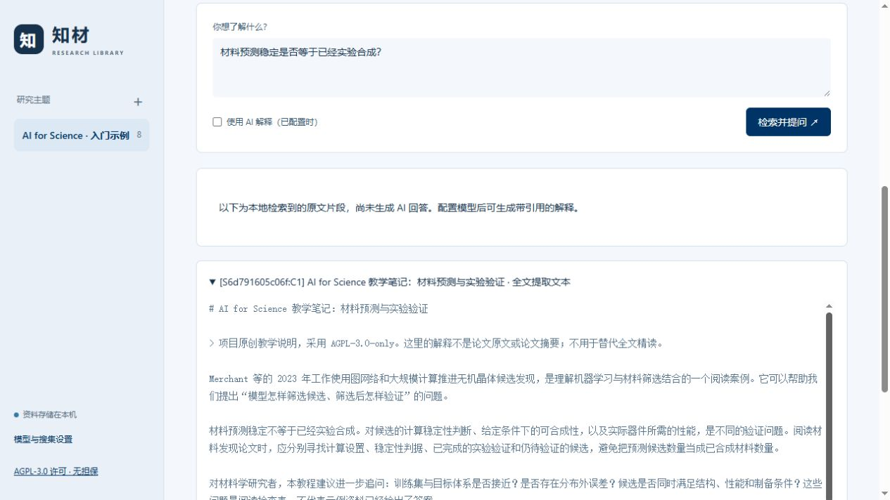

# AI for Science 标准示例教程

这份教程演示“建立主题 → 整理资料 → 检查 IF 和阅读顺序 → 导出 → 综述与方向 → 知识库问答”。先运行不依赖网络或模型的固定示例，再使用自己的配置完成联网与 AI 工作流。

## 示例包含什么

输入在 [sources.json](sources.json)，共 8 条：

| 类型 | 数量 | 内容范围 | 用途 |
| --- | ---: | --- | --- |
| Nature 论文 | 3 | 仅书目，没有论文摘要或正文 | 观察 DOI、作者、缺失单位、期刊 IF 与阅读排序 |
| 书籍 | 1 | 仅书目 | 观察书籍不套用期刊 IF、不据此生成书中结论 |
| 机构介绍页 | 1 | 仅网址及元信息 | 演示可信网站入口，后续可自行补充网页内容 |
| 项目原创教学笔记 | 3 | 这三份笔记本身的全文 | 体验本地检索、证据引用与资料文件 |

论文入口为 Wang 等的 AI for Science 综述、Jumper 等的 AlphaFold 工作、Merchant 等的材料发现工作；书籍为 Murphy 的 *Probabilistic Machine Learning: An Introduction*。这些是入门示例，不是 2026 年最新进展清单。

三份笔记见 [问题与研究流程](notes/01-overview.md)、[材料预测与验证](notes/02-materials.md)、[跨领域案例与方法](notes/03-methods.md)。**它们是原创教学解释，不能当作论文原文或书籍章节。** 论文与书籍的版权不因本教程而改变，许可范围见 [第三方声明](../../THIRD_PARTY_NOTICES.md)。

## 第一步：安装并建立独立示例库

下载或克隆项目后，在项目根目录打开终端。首次安装使用以下 PowerShell 命令：

```powershell
python -m venv .venv
.\.venv\Scripts\python.exe -m pip install -r requirements.txt -c constraints-tested.txt
.\.venv\Scripts\python.exe scripts/create_example.py
.\.venv\Scripts\python.exe run.py --port 8766 --data-dir .test-output/ai-for-science-demo
```

打开 <http://127.0.0.1:8766>，点击左侧 **AI for Science · 入门示例**。这份示例库位于 `.test-output/ai-for-science-demo`；不会读写原有 `data/` 资料库。

创建脚本不联网、不加载 `.env`、不调用模型。如果目录已经存在且非空，它会拒绝覆盖。再次体验时换一个目录，并让创建和启动命令使用同一个路径：

```powershell
.\.venv\Scripts\python.exe scripts/create_example.py --data-dir .test-output/ai-for-science-demo-2
.\.venv\Scripts\python.exe run.py --port 8766 --data-dir .test-output/ai-for-science-demo-2
```

运行网页服务时仍会按主 README 加载你已有的模型设置；下方离线步骤不要点击 AI 按钮，并取消勾选问答中的“使用 AI 解释”。新用户没有模型配置也能完成这些步骤。

## 第二步：核对资料，而不是直接相信字段齐全

首次打开应看到 **8 条资料、3 条有文本、0/2 份报告**。资料 ID 和获取时间由本次运行生成，因此与你在其他机器上看到的不同是正常的。

点击一篇论文检查题名、作者、DOI、来源和内容范围。作者单位在本次元数据快照中缺失，应保持“未提供”，不能根据作者当前主页或机构名称补猜。查看书籍条目时，应只有书目信息，不能把它当作读过整本书。

点击原创笔记，检查开头的教学说明及“下载原件”。这里的“全文”只表示这份笔记的全文。示例不自动替你勾选“已人工核验”；阅读并核对后再决定是否标记。

## 第三步：查看 IF 与重要度

默认选择“重要度优先”，也可以切换“已核实 IF 优先”。在当前指标快照中，3 篇 Nature 论文会匹配到同一个期刊指标，书籍、网站和教学笔记不套用期刊 IF。

打开 IF 来源链接，核对期刊、指标年份和核实日期。这里使用仓库已有的出版社指标快照，**不是论文发表当年的 IF**；它也不代表单篇论文质量。本示例未填入实时引用次数，缺失值不应该显示成 0。

“刷新 IF 与重要度”会按现有数据重新排序；分数还受相关性、文本覆盖和年份影响。排序帮助安排阅读，不是科研成果排行榜。固定示例没有执行联网搜集，因此不会产生真实的候选热度统计。

## 第四步：体验本地问答

进入“知识库问答”，取消勾选“使用 AI 解释”，输入：

> 材料预测稳定是否等于已经实验合成？

预期看到“尚未生成 AI 回答”的说明和相关原文片段。片段应来自原创材料教学笔记，可以打开对应资料核对，而不是来自只有书目的论文。

还可以尝试：“学习 AI for Science 需要怎样的知识脉络？”本地检索受关键词影响，必要时换用中英文词。没有模型时显示片段不等于已经生成了完整答案。

创建脚本也将同一问题的实际离线检索结果保存为 `.test-output/ai-for-science-demo/offline-qa.json`，方便检查证据来源。

下面是按上述步骤得到的实际页面，截图中的资料 ID 随运行生成：



## 第五步：导出 Excel 与独立资料文件

点击“下载主题资料包”，解压后再打开 `资料目录.xlsx`。资料目录应有 8 行资料，包含中英文题名、来源、作者、作者单位、简介、网址、IF、重要度及资料文件链接；长字段可在独立资料卡中完整查看。

Excel 的“独立资料文件”列应能打开同一解压目录中 `sources/` 下的 Markdown 文件。原始教学笔记保存在 `originals/` 中，结构化记录在 `records/` 中。单独下载 Excel 不会同时下载这些配套文件。

脚本已使用应用自身的导出功能生成初始文件：

```text
.test-output/ai-for-science-demo/
  library.sqlite3
  demo-manifest.json
  offline-qa.json
  topics/1/
    资料目录.xlsx
    主题资料包.zip
    sources/       # 8 份资料卡
    records/       # 8 份记录
    originals/     # 3 篇原创笔记
```

修改资料后需要重新导出；直接编辑 Excel 不会反向修改资料库。示例创建时没有调用模型，所以没有生成报告。

## 第六步：用真实联网搜集扩展这个主题

建议在同一个示例库中新建 **AI for Science · 联网实践**，与固定输入分开，便于比较自动搜索和已知书目。

| 设置 | 示例值 |
| --- | --- |
| 主题名称 | AI for Science · 联网实践 |
| 检索关键词 | `artificial intelligence scientific discovery; machine learning materials discovery; autonomous scientific discovery` |
| 可信网站域名 | `nature.com, deepmind.google, energy.gov` |
| 筛选策略 | 按主题热度自动调整 |
| 每个来源最多收录 | 5 |

点击“联网搜集”。Crossref 和 Open Library 无需模型配置；配置 OpenAlex 或 Brave 后才会增加对应来源。可信域名列表只是网站搜索范围，需要 Brave 配置才会执行网站自动搜索；已知网址可直接手动导入。

记录每个来源的成功、失败、候选数量和暂缓原因，并下载候选审计文件。搜索结果随网络、数据库和日期变化，不要求得到固定数量；某个来源失败时，不把它解释为“这个领域没有资料”。热度衡量的是本次候选集，不是整个领域的发文总量。

复核题名与摘要是否相关，排除不相关、重复版本或明显有问题的条目。补充代表性资料，例如下列原始入口：

- [Wang 等，Scientific discovery in the age of artificial intelligence](https://doi.org/10.1038/s41586-023-06221-2)
- [Jumper 等，Highly accurate protein structure prediction with AlphaFold](https://doi.org/10.1038/s41586-021-03819-2)
- [Merchant 等，Scaling deep learning for materials discovery](https://doi.org/10.1038/s41586-023-06735-9)
- [Murphy，Probabilistic Machine Learning: An Introduction](https://probml.github.io/pml-book/book1.html)
- [Google DeepMind 的机构介绍](https://deepmind.google/blog/millions-of-new-materials-discovered-with-deep-learning/)

从“导入资料”读取公开网址，或上传有权使用的 PDF/TXT/Markdown。核对抽取文本是否真的是正文：登录提示、导航和参考文献不能当成主要证据。遇到 403、证书错误或无法抓取时，可合法下载后上传，或明确标记为只有书目；不要关闭证书检查或放开内网访问。

## 第七步：连接模型，生成综述和方向总结

按照 [主 README 的模型配置说明](../../README.md#配置模型和可选搜索服务)，选择本机官方 Codex CLI 或兼容模型 API，再在“模型与搜集设置”中测试连接。每个使用者配置自己的登录或 API；仓库不提供共享账户。相关片段会发送到所选服务，真实调用可能使用额度或产生费用。

在已补充原文的联网主题中，依次操作：

1. 点击“AI 整理资料”，检查译名、简介和主要内容是否受到已有文本支持。
2. 进入“综述与方向”，点击“生成综述”和“生成方向总结”。
3. 检查每个事实性段落的引用、参考资料和证据覆盖清单，确认没有把摘要描述成通读全文。
4. 用“当前证据不足以判断什么？”和一个具体科学问题测试问答，逐条点击引用核对。
5. 资料有增补或更正后，重新生成报告并重新导出资料包。

也可以先对固定示例中的 3 篇原创笔记体验生成按钮，但得到的是教学笔记的整理结果，不是原论文综述。5 条只有书目的资料不能支持详细研究结论。模型输出并不固定；正确的引用格式也不能替代对内容的人工检查。

仓库附有 [综述格式范文](review-example.md) 和 [方向总结范文](direction-example.md)。两者是原创教学范文，未伪装成某次模型运行结果，也不会被脚本提前写成“已生成报告”。

## 完成检查

- 固定示例有 8 条资料、3 份原始教学笔记，5 条书目没有伪造正文；初始报告为 0。
- 离线问答能检索到笔记证据；无模型时不会冒充 AI 回答。
- Excel 有 8 行资料，相对文件链接在 ZIP 解压后有效；期刊 IF 有年份及来源，缺失指标不记为 0。
- 联网搜集的失败、筛选及补充过程有记录；真实报告引用可追溯，证据不足处得到说明。
- 示例输入及范文可以随源码发布；本地数据库、模型配置、真实登录凭据和自行下载的原文不上传。

兼容性、检查命令及发布范围见 [发布准备说明](../../docs/RELEASE_PREPARATION.md)。
